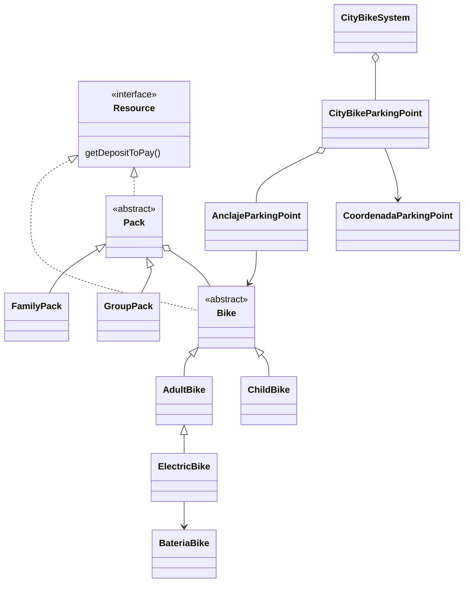

<div align="center">

# CityBike: alquiler de bicicletas urbanas en Java

**Modelo orientado a objetos de un sistema de alquiler y reserva de bicis, con jerarquía polimórfica de recursos y 48 pruebas JUnit que pasan**


<sub>Programación Orientada a Objetos · Grado en Ingeniería Informática · Universidad de Valladolid · Curso 2021-2022</sub>

</div>



## En pocas palabras

- **Reto:** modelar un servicio de bicis urbanas con varios tipos de bici y de pack, cada uno con su propia regla de fianza, sin que el código de alquiler dependa del tipo concreto.
- **Solución:** una jerarquía de clases bajo la interfaz `Resource`, puntos de aparcamiento con anclajes y búsquedas por posición GPS, todo cubierto por pruebas JUnit.
- **Demuestra:** diseño orientado a objetos (herencia, polimorfismo, encapsulación), validación defensiva, pruebas unitarias y documentación con Javadoc.

## Lo más destacado

- **48 pruebas JUnit que pasan** en `practica2Test` (`AdultBikeTest`, `GroupPackTest` y `PolimorfismoTest`), comprobado con JDK 17 y JUnit 4.13.2.
- **Polimorfismo real:** el alquiler cobra la fianza de cada recurso mediante `getDepositToPay` sin saber su tipo. La bici infantil paga el 85 %, la eléctrica un recargo del 24 %, 36 % o 48 % según el voltaje, el pack familiar el 50 % de la suma y el de grupo el 80 %.
- **Invariantes protegidos con excepciones:** un `FamilyPack` no baja de 4 bicis ni de 2 infantiles, un `GroupPack` no baja de 10 y ningún pack admite bicis repetidas.
- **Búsquedas geográficas:** `CoordenadaParkingPoint` admite grados decimales o grados, minutos y segundos, y calcula distancias con la fórmula del haversine para localizar puntos dentro de un radio.
- **Validación sistemática** de argumentos (`IllegalArgumentException`) y de estado (`IllegalStateException`), por ejemplo con saldo insuficiente o un anclaje vacío o reservado.
- **Javadoc generado** en [`entrega1-jagarci-fralomo/doc/index.html`](entrega1-jagarci-fralomo/doc/index.html).

## Competencias

| Área | Qué se aplicó |
|------|---------------|
| Diseño OO | Interfaz, clases abstractas, herencia en varios niveles (`ElectricBike extends AdultBike extends Bike`) |
| Calidad | Validación de argumentos y estado, `equals`, `toString` y `clone` redefinidos en todo el modelo |
| Pruebas | JUnit 4, 48 casos |
| Documentación | Javadoc completo del modelo |

## Qué hace

- **`CityBikeSystem`** gestiona los puntos de aparcamiento: altas, bajas y búsquedas por identificador. También localiza los puntos con bicis disponibles, con anclajes vacíos o situados dentro de un radio alrededor de una posición GPS.
- **`CityBikeParkingPoint`** gestiona sus anclajes y permite alquilar, reservar y devolver bicis o packs. La fianza se cobra y se reembolsa en una `TarjetaMonedero`, una librería externa que proporcionaba la asignatura.
- **Tipos de recurso:** `AdultBike`, `ChildBike`, `ElectricBike` (con `BateriaBike`), `FamilyPack` y `GroupPack`.

## Estructura del repositorio

```
POO/
└── entrega1-jagarci-fralomo/        # proyecto de Eclipse
    ├── src/uva/poo/
    │   ├── practica1/               # sistema, puntos de aparcamiento, anclajes, coordenadas
    │   ├── practica2/               # Resource, Bike y Pack con sus subclases
    │   └── practica2Test/           # pruebas JUnit 4
    ├── lib/                         # TarjetaMonedero.class (librería de la asignatura)
    ├── bin/                         # clases compiladas
    └── doc/                         # Javadoc
```

## Requisitos

- JDK 11 o superior (proyecto de Eclipse configurado para JavaSE-11)
- JUnit 4 (`junit-4.x.jar` y `hamcrest-core-1.3.jar`), solo para ejecutar las pruebas

## Cómo ejecutarlo

El proyecto se puede importar directamente en Eclipse (*File → Import → Existing Projects into Workspace*).

<details>
<summary>Compilar y lanzar las pruebas desde la línea de comandos</summary>

```bash
cd entrega1-jagarci-fralomo
javac -d out -cp "lib:junit-4.13.2.jar" $(find src -name "*.java")
java -cp "out:lib:junit-4.13.2.jar:hamcrest-core-1.3.jar" org.junit.runner.JUnitCore \
  uva.poo.practica2Test.AdultBikeTest \
  uva.poo.practica2Test.GroupPackTest \
  uva.poo.practica2Test.PolimorfismoTest
```

Sustituye las rutas de los `.jar` por las de tu instalación de JUnit.

</details>

## Estado y limitaciones

- Es una biblioteca de clases: no tiene método `main` ni interfaz de usuario.
- Depende de `TarjetaMonedero`, una librería compilada de la asignatura que se incluye en `lib/`.

## Autoría

Trabajo en pareja. Los commits y las etiquetas `@author` del código corresponden a Javier García (`jagarci`) y a `fralomo`.

---

<div align="center"><sub>Parte de <a href="https://github.com/JavivuG/UVa-Projects">UVa-Projects</a> · Javier García González</sub></div>
